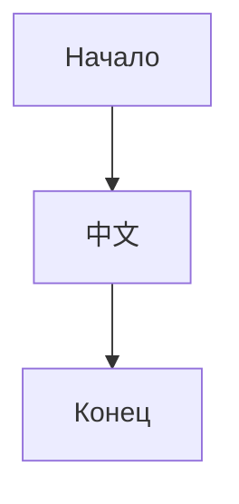

## Media

Локальное изображение:


HTML-изображение:


Удалённое изображение:




```flow
st=>start: Старт
e=>end: Конец
st->e
```

```sequence
Алиса->Боб: Привет
Боб-->Алиса: Ответ
```

<iframe src="https://example.invalid/" width="400" height="200"></iframe>

<audio src="a.mp3" controls></audio>

<video src="v.mp4" controls></video>

Конец media-блока.
