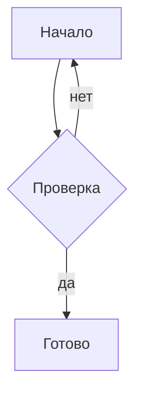
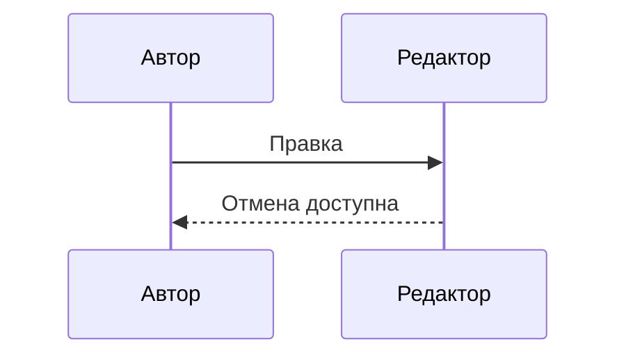

# Проверка возможностей Typora

Этот документ — набор контрольных примеров, а не подтверждение готовности функций.
Для каждого примера отдельно проверяются исходник, оформленный редактор, выделение,
отмена, сохранение, предпросмотр и поддерживаемые форматы вывода.

[toc]

## Текст и выделение

Русский, 中文, English, 😀, 👨‍👩‍👧‍👦, é. **Жирный _с курсивом_**,
~~зачёркивание~~, `literal **code**`, ==выделение==, H~2~O, x^2^,
<u>подчёркивание</u>, :smile: и :unknown_shortcode_for_acceptance:.

Экранированные \*звёздочки\*, &amp;, &#x1F600;, кавычки "text" и -- тире.
Выделить отдельно слово внутри жирного текста и часть содержимого кода;
сравнить обычное копирование, Markdown, HTML-код и вставку исходника.

## Списки и цитаты

1. Первый пункт
   - Вложенный пункт
     - [ ] Невыполненная задача
     - [x] Выполненная задача
2. Второй пункт

> Цитата с **оформлением**.
>
> [!NOTE]
> Уведомление с несколькими строками.
>
> > Вложенная цитата.

## Таблицы

| Левая | Центр | Правая |
| :--- | :---: | ---: |
| **中😀** | `a\|b` | [ссылка](https://example.com) |
| короткая |
| первая<br>вторая | a\\\|b | последняя |

> | A | B |
> | --- | --- |
> | цитата | **ячейка** |

- Таблица в списке:

  | A | B |
  | --- | --- |
  | список | ячейка |

## Ссылки и сноски

[Внешняя](https://example.com "Подсказка"), <https://example.com>,
[по определению][reference], [локальный файл](typora-baseline.md),
[якорь](#текст-и-выделение), сноска[^note] и повторная ссылка[^note].

[reference]: https://example.com/path?q=%E4%B8%AD "Reference title"

[^note]: Первый абзац с **оформлением**.

    Второй абзац определения с `кодом`.

## Изображения и медиа


Строчное изображение  между словами.

Ниже намеренно недоступные локальные файлы: проверить видимую ошибку/исходник,
затем подставить существующие файлы из отдельной временной папки приёмки.

<audio src="missing.wav" />

<video src="missing.mp4" controls></video>

## Формулы

Общий макрос $\def\parityvar{x}$; строчная дробь $\frac{a}{b}$ между словами,
высокая формула $\begin{pmatrix}a&b\\c&d\end{pmatrix}$ и ссылка $\ref{parity:eq}$.

$$
\parityvar^2 + y^2 = z^2 \tag{1}\label{parity:eq}
$$

> $$
> \frac{\alpha}{\beta}
> $$

## Диаграммы





## Код и HTML

```swift
let text = "中文 😀 **literal**"
// # Not an outline heading
// [toc]
```

<span style="color: red">Цвет текста</span>, <kbd>⌘</kbd>+<kbd>B</kbd>,
<ruby>漢<rt>かん</rt></ruby>.

<!-- Комментарий не должен отображаться в печати.  -->

<div style="page-break-after: always; break-after: page;"></div>

## После разрыва страницы

Проверить поиск, оглавление, выделение, восстановление сессии и PDF-закладку.
